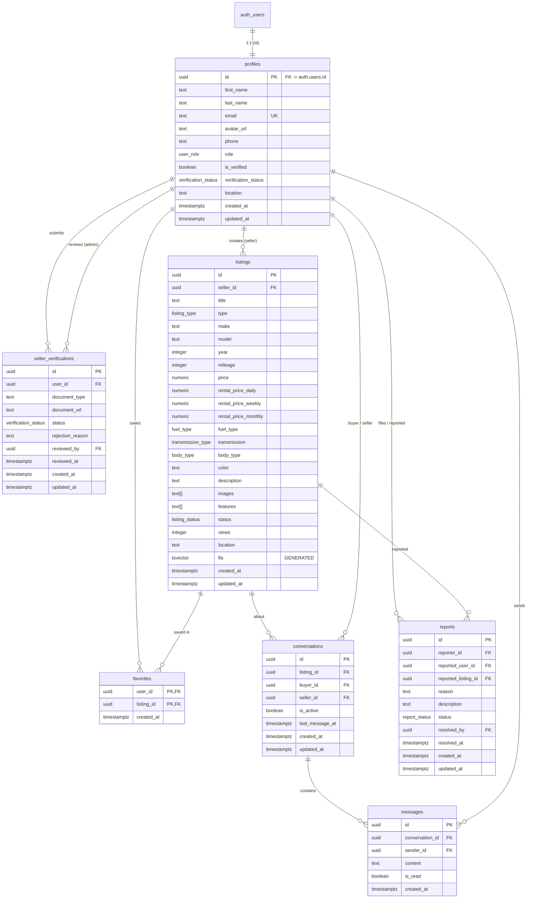

# 33-AutoHub — Database Documentation

> **Engine:** PostgreSQL (via [Supabase](https://supabase.com/))
> **Schema Source:** [`supabase/schema.sql`](../supabase/schema.sql)
> **Seed Data:** [`supabase/seed.sql`](../supabase/seed.sql)
> **Setup Script:** [`scripts/init_db.py`](../scripts/init_db.py)

---

## 1. Overview

33-AutoHub uses **Supabase (PostgreSQL)** as its primary database, authentication provider, real-time messaging backbone, and file storage layer.

Key architectural choices:
- **Authentication Isolation**: User credentials (`encrypted_password`, tokens, OAuth state) are managed exclusively by Supabase Auth in `auth.users`. Public user metadata lives in `public.profiles` and is kept in sync via database triggers.
- **Row-Level Security (RLS)**: Enabled on every table in the `public` schema to enforce authorization at the database layer.
- **Built-in Search**: Uses PostgreSQL `tsvector` full-text search (`fts` generated column) and `pg_trgm` trigram GIN indexes for fast vehicle search and filtering.
- **Real-Time Messaging**: `public.messages` and `public.conversations` are published to `supabase_realtime` for live chat updates.

### Enabled Extensions
- `uuid-ossp` — UUID utilities
- `pg_trgm` — Trigram similarity indexing for fuzzy matching on vehicle `make` and `model`

---

## 2. Entity-Relationship Diagram



---

## 3. Custom Enum Types

| Enum Name | Allowed Values |
|---|---|
| `user_role` | `buyer`, `seller`, `both`, `admin` |
| `verification_status` | `none`, `pending`, `approved`, `rejected` |
| `listing_type` | `sale`, `rent` |
| `listing_status` | `active`, `sold`, `rented`, `removed` |
| `fuel_type` | `petrol`, `diesel`, `electric`, `hybrid` |
| `transmission_type` | `manual`, `automatic` |
| `body_type` | `sedan`, `suv`, `hatchback`, `coupe`, `truck`, `van`, `convertible` |
| `report_status` | `pending`, `reviewed`, `resolved` |

---

## 4. Tables Reference

### 4.1 `public.profiles`
Public user profile linked 1:1 with `auth.users`. Automatically populated on signup via the `on_auth_user_created` trigger.

| Column | Type | Constraints | Description |
|---|---|---|---|
| `id` | `UUID` | `PRIMARY KEY`, `FK -> auth.users(id) ON DELETE CASCADE` | Matches Supabase Auth user ID |
| `first_name` | `TEXT` | `NOT NULL` | User first name |
| `last_name` | `TEXT` | `NOT NULL` | User last name |
| `email` | `TEXT` | `NOT NULL`, `UNIQUE` | User email address |
| `avatar_url` | `TEXT` | Nullable | Profile picture URL |
| `phone` | `TEXT` | Nullable | Contact phone number |
| `role` | `user_role` | `NOT NULL`, `DEFAULT 'buyer'` | Account role |
| `is_verified` | `BOOLEAN` | `NOT NULL`, `DEFAULT FALSE` | Verified seller badge flag |
| `verification_status` | `verification_status` | `NOT NULL`, `DEFAULT 'none'` | Current KYC/verification state |
| `location` | `TEXT` | Nullable | City / region |
| `created_at` | `TIMESTAMPTZ` | `NOT NULL`, `DEFAULT NOW()` | Creation timestamp |
| `updated_at` | `TIMESTAMPTZ` | `NOT NULL`, `DEFAULT NOW()` | Auto-updated on change |

---

### 4.2 `public.seller_verifications`
Tracks identity/address verification documents submitted by sellers and reviewed by admins.

| Column | Type | Constraints | Description |
|---|---|---|---|
| `id` | `UUID` | `PRIMARY KEY`, `DEFAULT gen_random_uuid()` | Verification record ID |
| `user_id` | `UUID` | `NOT NULL`, `FK -> profiles(id) ON DELETE CASCADE` | Submitting seller |
| `document_type` | `TEXT` | `NOT NULL` | e.g., `national_id`, `passport`, `driver_license`, `utility_bill` |
| `document_url` | `TEXT` | `NOT NULL` | Path/URL in private storage |
| `status` | `verification_status` | `NOT NULL`, `DEFAULT 'pending'` | Review status |
| `rejection_reason` | `TEXT` | Nullable | Reason if rejected |
| `reviewed_by` | `UUID` | `FK -> profiles(id) ON DELETE SET NULL` | Admin who reviewed |
| `reviewed_at` | `TIMESTAMPTZ` | Nullable | Review timestamp |
| `created_at` | `TIMESTAMPTZ` | `NOT NULL`, `DEFAULT NOW()` | Submission timestamp |
| `updated_at` | `TIMESTAMPTZ` | `NOT NULL`, `DEFAULT NOW()` | Auto-updated on change |

---

### 4.3 `public.listings`
Stores vehicle listings for both outright **sale** and **rental**.

| Column | Type | Constraints | Description |
|---|---|---|---|
| `id` | `UUID` | `PRIMARY KEY`, `DEFAULT gen_random_uuid()` | Listing ID |
| `seller_id` | `UUID` | `NOT NULL`, `FK -> profiles(id) ON DELETE CASCADE` | Listing owner |
| `title` | `TEXT` | `NOT NULL` | Listing headline |
| `type` | `listing_type` | `NOT NULL`, `DEFAULT 'sale'` | `sale` or `rent` |
| `make` | `TEXT` | `NOT NULL` | Manufacturer (e.g., `BMW`) |
| `model` | `TEXT` | `NOT NULL` | Model name (e.g., `M3`) |
| `year` | `INTEGER` | `NOT NULL`, `CHECK (year >= 1900 AND year <= current_year + 2)` | Model year |
| `mileage` | `INTEGER` | `NOT NULL`, `CHECK (mileage >= 0)` | Vehicle mileage |
| `price` | `NUMERIC(12, 2)` | `NOT NULL`, `CHECK (price >= 0)` | Sale price (or vehicle value) |
| `rental_price_daily` | `NUMERIC(10, 2)` | `CHECK (>= 0)` | Daily rental rate |
| `rental_price_weekly` | `NUMERIC(10, 2)` | `CHECK (>= 0)` | Weekly rental rate |
| `rental_price_monthly` | `NUMERIC(10, 2)` | `CHECK (>= 0)` | Monthly rental rate |
| `fuel_type` | `fuel_type` | `NOT NULL` | Fuel category |
| `transmission` | `transmission_type` | `NOT NULL` | `manual` or `automatic` |
| `body_type` | `body_type` | `NOT NULL` | Vehicle body style |
| `color` | `TEXT` | Nullable | Exterior color |
| `description` | `TEXT` | Nullable | Detailed description |
| `images` | `TEXT[]` | `NOT NULL`, `DEFAULT '{}'`, `CHECK (cardinality(images) <= 10)` | Up to 10 image URLs |
| `features` | `TEXT[]` | `NOT NULL`, `DEFAULT '{}'` | Feature tags |
| `status` | `listing_status` | `NOT NULL`, `DEFAULT 'active'` | Availability status |
| `views` | `INTEGER` | `NOT NULL`, `DEFAULT 0`, `CHECK (views >= 0)` | View counter |
| `location` | `TEXT` | Nullable | Vehicle location |
| `fts` | `TSVECTOR` | `GENERATED ALWAYS AS (...) STORED` | Full-text search vector (`title`, `make`, `model`, `description`) |
| `created_at` | `TIMESTAMPTZ` | `NOT NULL`, `DEFAULT NOW()` | Creation timestamp |
| `updated_at` | `TIMESTAMPTZ` | `NOT NULL`, `DEFAULT NOW()` | Auto-updated on change |

- **Table Constraint `chk_rental_pricing`**: When `type = 'rent'`, at least one of `rental_price_daily`, `rental_price_weekly`, or `rental_price_monthly` must be non-null.

---

### 4.4 `public.favorites`
Join table for buyers saving listings.

| Column | Type | Constraints | Description |
|---|---|---|---|
| `user_id` | `UUID` | `PRIMARY KEY`, `FK -> profiles(id) ON DELETE CASCADE` | User who saved |
| `listing_id` | `UUID` | `PRIMARY KEY`, `FK -> listings(id) ON DELETE CASCADE` | Saved listing |
| `created_at` | `TIMESTAMPTZ` | `NOT NULL`, `DEFAULT NOW()` | Saved timestamp |

---

### 4.5 `public.conversations`
Threaded chat sessions between a buyer and a seller about a specific listing.

| Column | Type | Constraints | Description |
|---|---|---|---|
| `id` | `UUID` | `PRIMARY KEY`, `DEFAULT gen_random_uuid()` | Conversation ID |
| `listing_id` | `UUID` | `NOT NULL`, `FK -> listings(id) ON DELETE CASCADE` | Referenced vehicle |
| `buyer_id` | `UUID` | `NOT NULL`, `FK -> profiles(id) ON DELETE CASCADE` | Initiating buyer |
| `seller_id` | `UUID` | `NOT NULL`, `FK -> profiles(id) ON DELETE CASCADE` | Listing seller |
| `is_active` | `BOOLEAN` | `NOT NULL`, `DEFAULT TRUE` | Whether messaging is open |
| `last_message_at` | `TIMESTAMPTZ` | `NOT NULL`, `DEFAULT NOW()` | Updated by trigger on new message |
| `created_at` | `TIMESTAMPTZ` | `NOT NULL`, `DEFAULT NOW()` | Creation timestamp |
| `updated_at` | `TIMESTAMPTZ` | `NOT NULL`, `DEFAULT NOW()` | Auto-updated on change |

- **Constraints**:
  - `chk_different_parties`: `buyer_id <> seller_id`
  - `uq_listing_buyer`: `UNIQUE (listing_id, buyer_id)` (one thread per buyer per listing)

---

### 4.6 `public.messages`
Individual chat messages within a conversation.

| Column | Type | Constraints | Description |
|---|---|---|---|
| `id` | `UUID` | `PRIMARY KEY`, `DEFAULT gen_random_uuid()` | Message ID |
| `conversation_id` | `UUID` | `NOT NULL`, `FK -> conversations(id) ON DELETE CASCADE` | Parent conversation |
| `sender_id` | `UUID` | `NOT NULL`, `FK -> profiles(id) ON DELETE CASCADE` | Message author |
| `content` | `TEXT` | `NOT NULL`, `CHECK (length(trim(content)) > 0)` | Non-empty message text |
| `is_read` | `BOOLEAN` | `NOT NULL`, `DEFAULT FALSE` | Read receipt status |
| `created_at` | `TIMESTAMPTZ` | `NOT NULL`, `DEFAULT NOW()` | Sent timestamp |

---

### 4.7 `public.reports`
Moderation reports submitted by users against listings or other users.

| Column | Type | Constraints | Description |
|---|---|---|---|
| `id` | `UUID` | `PRIMARY KEY`, `DEFAULT gen_random_uuid()` | Report ID |
| `reporter_id` | `UUID` | `NOT NULL`, `FK -> profiles(id) ON DELETE CASCADE` | User filing the report |
| `reported_user_id` | `UUID` | `FK -> profiles(id) ON DELETE SET NULL` | Reported user (optional) |
| `reported_listing_id` | `UUID` | `FK -> listings(id) ON DELETE SET NULL` | Reported listing (optional) |
| `reason` | `TEXT` | `NOT NULL` | Report category/reason |
| `description` | `TEXT` | Nullable | Additional details |
| `status` | `report_status` | `NOT NULL`, `DEFAULT 'pending'` | Moderation status |
| `resolved_by` | `UUID` | `FK -> profiles(id) ON DELETE SET NULL` | Admin who resolved |
| `resolved_at` | `TIMESTAMPTZ` | Nullable | Resolution timestamp |
| `created_at` | `TIMESTAMPTZ` | `NOT NULL`, `DEFAULT NOW()` | Creation timestamp |
| `updated_at` | `TIMESTAMPTZ` | `NOT NULL`, `DEFAULT NOW()` | Auto-updated on change |

- **Constraint `chk_report_target`**: At least one of `reported_user_id` or `reported_listing_id` must be non-null.

---

## 5. Indexes

| Table | Index Name | Type / Columns | Purpose |
|---|---|---|---|
| `profiles` | `idx_profiles_role` | B-Tree `(role)` | Filter users by role |
| `profiles` | `idx_profiles_verification_status` | B-Tree `(verification_status)` | Admin verification queue |
| `listings` | `idx_listings_fts` | GIN `(fts)` | Full-text search |
| `listings` | `idx_listings_make_trgm` | GIN `(make gin_trgm_ops)` | Fuzzy search on make |
| `listings` | `idx_listings_model_trgm` | GIN `(model gin_trgm_ops)` | Fuzzy search on model |
| `listings` | `idx_listings_filter_core` | B-Tree `(status, type, price, year)` | Core marketplace filters & sorting |
| `listings` | `idx_listings_seller_created` | B-Tree `(seller_id, created_at DESC)` | Seller dashboard listings |
| `listings` | `idx_listings_body_fuel` | B-Tree `(body_type, fuel_type, transmission)` | Vehicle attribute filters |
| `conversations` | `idx_conversations_buyer` | B-Tree `(buyer_id, last_message_at DESC)` | Buyer inbox ordering |
| `conversations` | `idx_conversations_seller` | B-Tree `(seller_id, last_message_at DESC)` | Seller inbox ordering |
| `conversations` | `idx_conversations_listing` | B-Tree `(listing_id)` | Lookup by listing |
| `messages` | `idx_messages_conversation_ordered` | B-Tree `(conversation_id, created_at ASC)` | Chronological chat history |
| `messages` | `idx_messages_sender` | B-Tree `(sender_id)` | Sender lookups |
| `messages` | `idx_messages_unread` | Partial B-Tree `(conversation_id, is_read) WHERE is_read = FALSE` | Unread message badge counts |
| `favorites` | `idx_favorites_user_created` | B-Tree `(user_id, created_at DESC)` | User saved listings |
| `seller_verifications` | `idx_seller_verifications_status` | B-Tree `(status)` | Pending verifications |
| `reports` | `idx_reports_status` | B-Tree `(status)` | Pending moderation reports |

---

## 6. Triggers & Functions

| Trigger | Table | Event | Function | Behavior |
|---|---|---|---|---|
| `on_auth_user_created` | `auth.users` | `AFTER INSERT` | `public.handle_new_user()` | Creates or updates the matching `public.profiles` row from auth metadata |
| `on_new_message_sent` | `public.messages` | `AFTER INSERT` | `public.handle_new_message()` | Updates `conversations.last_message_at` and `updated_at` |
| `on_verification_status_updated` | `public.seller_verifications` | `AFTER INSERT OR UPDATE OF status` | `public.sync_profile_verification()` | Syncs `profiles.is_verified` and `profiles.verification_status` |
| `trg_*_updated_at` | `profiles`, `seller_verifications`, `listings`, `conversations`, `reports` | `BEFORE UPDATE` | `update_updated_at_column()` | Sets `updated_at = NOW()` |

Helper function:
- `public.is_admin()` (`SECURITY DEFINER STABLE`) — Returns `TRUE` if `auth.uid()` has `role = 'admin'` in `public.profiles`.

---

## 7. Row-Level Security (RLS) Summary

All tables in `public` have RLS enabled:

| Table | `SELECT` | `INSERT` | `UPDATE` | `DELETE` |
|---|---|---|---|---|
| `profiles` | Public (`TRUE`) | Trigger-managed (`auth.users`) | Owner or Admin | Cascade from `auth.users` |
| `seller_verifications` | Owner or Admin | Owner (`auth.uid() = user_id`) | Admin only | — |
| `listings` | `status = 'active'`, Owner, or Admin | Owner with `role IN ('seller', 'both', 'admin')` | Owner or Admin | Owner or Admin |
| `favorites` | Owner (`auth.uid() = user_id`) | Owner | — | Owner |
| `conversations` | Buyer, Seller, or Admin | Buyer (`auth.uid() = buyer_id`) | Buyer, Seller, or Admin | — |
| `messages` | Conversation participants or Admin | Active conversation participant (`auth.uid() = sender_id`) | Conversation participants (`is_read` updates) | — |
| `reports` | Reporter or Admin | Authenticated (`auth.uid() = reporter_id`) | Admin only | — |

---

## 8. Realtime & Storage Buckets

### Realtime
The `supabase_realtime` publication includes:
- `public.messages`
- `public.conversations`

### Storage Buckets
| Bucket ID | Visibility | Upload Policy | Read Policy | Delete Policy |
|---|---|---|---|---|
| `listing-images` | Public | Authenticated users | Public | Owner (`storage.foldername(name)[1] = auth.uid()`) |
| `verification-docs` | Private | Owner (`storage.foldername(name)[1] = auth.uid()`) | Owner or Admin | — |

---

## 9. Setup & Initialization

### Option A: Supabase SQL Editor (Recommended)
1. Open your Supabase project's **SQL Editor**.
2. Paste and run [`supabase/schema.sql`](../supabase/schema.sql).
3. *(Optional)* Paste and run [`supabase/seed.sql`](../supabase/seed.sql) to load demo users, listings, favorites, and a sample conversation.

### Option B: Python Migration Script
1. Install dependencies:
   ```bash
   pip install -r requirements.txt
   ```
2. Copy [`.env.example`](../.env.example) to `.env` and set `SUPABASE_DB_URL` (use the Supabase **Session Pooler** URI if your network is IPv4-only).
3. Run the initializer:
   ```bash
   # Apply schema
   python scripts/init_db.py

   # Apply schema and seed demo data
   python scripts/init_db.py --seed

   # Verify connection and tables
   python scripts/init_db.py --check
   ```
